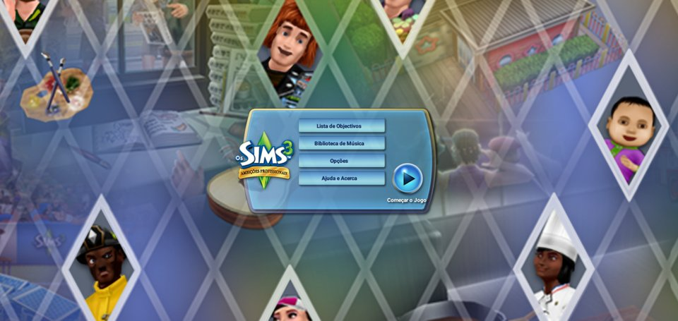

# The Sims 3 Ambições — port comunitário para Android

Port de **The Sims 3 Ambitions** (EA, 2010–2015), lançado apenas para iPhone/iPad e
abandonado, para celulares Android de 32 e 64 bits.



## Como funciona

O app **não contém o jogo**. Ele é um *loader*: carrega o executável original do iOS
(código ARMv7 ou ARM64, conforme o aparelho) diretamente na CPU do celular e reimplementa, por cima do Android, as partes
do iOS que o jogo usa (UIKit, Foundation, OpenGL ES, OpenAL, AudioToolbox, CoreGraphics…).
Cada jogador fornece a própria cópia do jogo (arquivo `.ipa` ou `.obb` convertido pela
ferramenta do port), que é importada na primeira execução.
Detalhes em [docs/02-ARQUITETURA.md](docs/02-ARQUITETURA.md).

## Status

Jogável no aparelho de teste (Samsung Galaxy A10, Android 10, Mali-G71) a ~60 FPS:
carregamento, menus, criação de Sim (com teclado do Android), mundo, tutorial, salvar e
carregar, pausa/retomada, música e efeitos sonoros, todos os 10 idiomas do jogo.

A partir do APK **0.2.0**, o mesmo instalador inclui `armeabi-v7a` e `arm64-v8a`.
O caminho de 32 bits foi verificado no A10: importação do OBB, menu, mundo, salvar/carregar
e pausa/retomada. O save gravado em 32 bits também foi carregado em 64 bits.
A instalação e execução no Galaxy J6 foram confirmadas pelo usuário com o APK **0.2.1**.
Sessões prolongadas e a cobertura dos demais recursos em 32 bits continuam em validação.

Acompanhe o andamento em [docs/SPRINTS.md](docs/SPRINTS.md).

## Documentação

- [Análise do binário](docs/01-ANALISE-BINARIO.md)
- [Arquitetura do port](docs/02-ARQUITETURA.md)
- [Compilação, testes e depuração](docs/03-COMPILAR.md)
- [Guia do jogador](docs/04-GUIA-DO-JOGADOR.md)
- [Continuidade do desenvolvimento](docs/05-DESENVOLVIMENTO.md)
- [Histórico das sprints](docs/SPRINTS.md)

## Para jogadores

Veja o [guia do jogador](docs/04-GUIA-DO-JOGADOR.md). Resumo:

1. Instale o APK (`TS3Ambitions-*.apk`).
2. Abra o app, toque em **Selecionar arquivo .ipa ou .obb** e escolha sua cópia do jogo
   em Downloads: IPA 1.1.84 descriptografado ou OBB convertido. Não precisa copiar para `Android/obb`.
3. Aguarde a importação (~1 minuto) e jogue.

Requisitos: Android 8.0+, CPU ARMv7 ou ARM64, OpenGL ES 1.1, ~700 MB para pacote e arquivos
instalados. O pacote pode ser apagado depois da importação, ficando ~450 MB instalados.

Para converter sua própria cópia no PC:

```bash
python3 tools/ipa_to_obb.py The_Sims_3_Ambitions_1.1.84.ipa dist/TS3Ambitions-1.1.84.obb
```

O OBB é um ZIP com os arquivos do jogo; a conversão valida as fatias ARM compatíveis, ausência de FairPlay e
a integridade de cada arquivo. O APK continua separado, sem conteúdo do jogo.

## Para desenvolvedores

Veja [docs/03-COMPILAR.md](docs/03-COMPILAR.md).

```
android/            projeto Android (Gradle + CMake)
  app/src/main/cpp/
    loader/         carregador Mach-O (rebase/bind) e stubs automáticos
    objc/           runtime Objective-C compatível com o ABI da Apple
    hle/            frameworks iOS reimplementados
    platform/       SDL2: janela, EGL, entrada, laço principal
docs/               documentação (análise, arquitetura, sprints, guias)
tools/              scripts de análise e de teste no aparelho
```

## Aviso legal

The Sims é marca registrada da Electronic Arts Inc. Este projeto não é afiliado nem
endossado pela EA. Nenhum código, arte, som ou dado do jogo é distribuído aqui; o usuário
deve possuir a própria cópia. O código deste repositório é a reimplementação independente
das APIs do iOS necessárias para executá-la.
