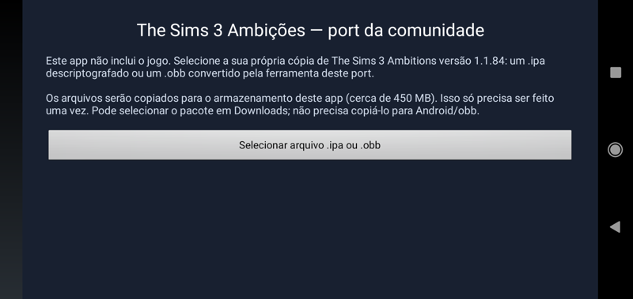

# Guia do jogador

## O que você precisa

- Celular ou tablet Android **8.0 ou mais novo**, com processador **ARMv7 (32 bits) ou
  ARM64 (64 bits)**. A partir do APK 0.2.0, o mesmo instalador atende às duas arquiteturas.
- Cerca de **700 MB** para o pacote e os arquivos instalados. Depois de importar, o pacote
  pode ser apagado, ficando cerca de **450 MB** instalados.
- Sua própria cópia de **The Sims 3 Ambitions versão 1.1.84**: arquivo `.ipa`
  **descriptografado** (sem o DRM FairPlay da App Store) ou um `.obb` convertido desse IPA
  pela ferramenta do port. O app não inclui o jogo.

## Instalação

1. Copie seu arquivo `.ipa` ou `.obb` para o celular (por exemplo, para a pasta Downloads).
2. Instale o APK do port (pode ser necessário permitir "instalar apps desconhecidos").
3. Abra **TS3 Ambitions**. Na primeira vez aparece a tela de importação:
   toque em **Selecionar arquivo .ipa ou .obb** e escolha o arquivo em Downloads.
4. Aguarde a barra de progresso (cerca de 1 minuto). O jogo abre sozinho ao terminar.

Depois disso, o `.ipa` ou `.obb` pode ser apagado do celular. Não precisa copiar o OBB para
`Android/obb`, renomeá-lo como `main.*.obb` ou extrair seus arquivos manualmente.

### Como obter o OBB da sua cópia

No PC, a ferramenta do projeto converte seu IPA em um OBB compatível:

```bash
python3 tools/ipa_to_obb.py The_Sims_3_Ambitions_1.1.84.ipa dist/TS3Ambitions-1.1.84.obb
```

O OBB contém os mesmos arquivos do jogo, compactados, e o app os importa automaticamente.
O conversor não descriptografa IPAs com DRM; a cópia de origem precisa estar descriptografada.
O formato é específico deste port: arquivos OBB de outros jogos não são compatíveis.



### Mensagens de erro do importador

| Mensagem | O que fazer |
|---|---|
| "O executável do jogo ainda está criptografado" | A cópia veio direto da App Store; é preciso uma versão descriptografada. |
| "não tem código armv7/arm64 compatível" | Use o IPA universal 1.1.84, com a fatia adequada ao Android do aparelho. |
| "não é um pacote .ipa ou .obb compatível" | Escolha o IPA correto ou um OBB gerado pela ferramenta deste port. |
| "não contém o executável" | O pacote não contém os arquivos completos do jogo. |
| "executável do jogo está incompleto ou inválido" | Copie ou converta o pacote novamente. |

## Jogando

- Toque e arraste funcionam como no iPhone.
- Ao nomear o Sim aparece uma caixa de texto do Android com o teclado; confirme com **OK**.
- O botão **Voltar** do Android pergunta se você quer sair. O jogo salva automaticamente
  ao sair ou ao ir para a tela inicial.
- O idioma segue o do Android, e pode ser trocado em **Opções → Idioma** dentro do jogo.

### Tamanho dos controles

A partir do APK **0.1.1**, celulares com tela Full HD+ usam automaticamente uma resolução
lógica menor para os ícones e botões terem tamanho proporcional semelhante ao do aparelho
720p de teste. O jogo continua preenchendo a tela, mantendo sua proporção. Há alguma perda
de nitidez pela ampliação da imagem, mas o custo de renderização também diminui.

Instale o novo APK por cima do anterior para aplicar o ajuste e preservar os saves.
Configurações manuais de `short_side`/`long_side` têm prioridade; veja o
[guia de compilação](03-COMPILAR.md#configuração-opcional) para ajustá-las.

## Onde ficam os saves

`Android/data/com.ts3ambitions.port/files/home/Documents/` (arquivos `sim3dat0`…`sim3dat6`
e `sim3set`). Copie essa pasta para fazer backup.

**Atenção:** desinstalar o app apaga essa pasta (regra do Android). Faça backup antes.

## Se o jogo fechar sozinho

O app grava um relatório em `Android/data/com.ts3ambitions.port/files/crash.txt`.
Ao relatar o problema, envie esse arquivo e diga o que estava fazendo no jogo.

## Limitações conhecidas

- O caminho de 32 bits foi testado no A10, forçando `armeabi-v7a`, com importação, mundo,
  salvar/carregar e pausa/retomada. Instalação e execução no Galaxy J6 foram confirmadas
  pelo usuário com o APK 0.2.1; sessões longas nesse caminho ainda estão em validação.
  O OBB já convertido da cópia universal contém ambas as fatias.
- "Biblioteca de Música" com músicas do aparelho (iPod no iOS) não está disponível: o seletor
  fecha sem escolher nada.
- Links externos (ajuda online da EA) abrem no navegador e podem estar fora do ar.
