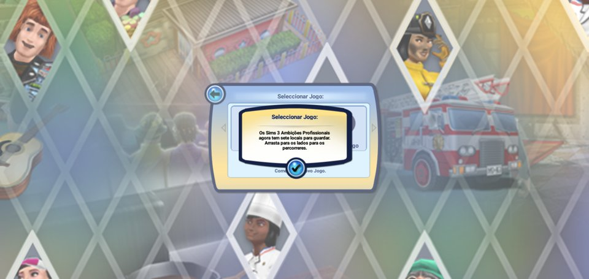
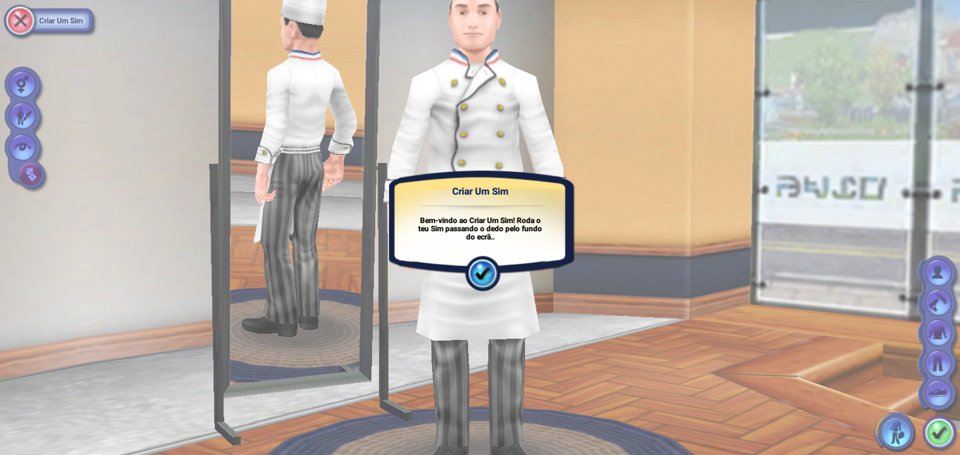
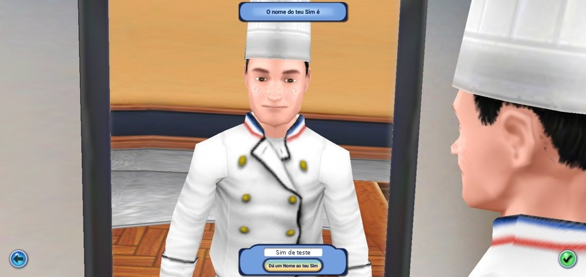
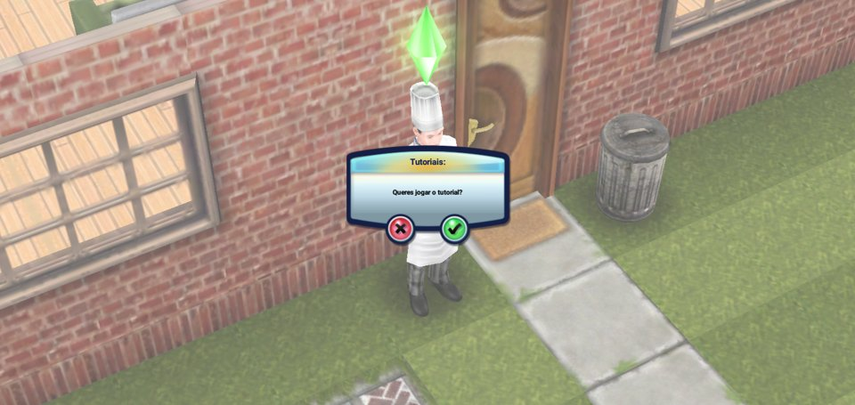
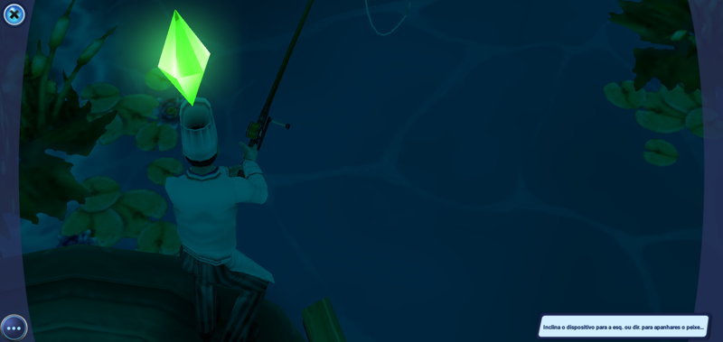
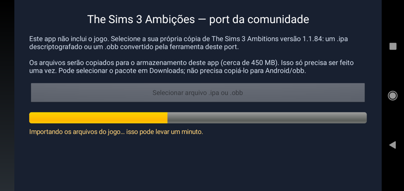
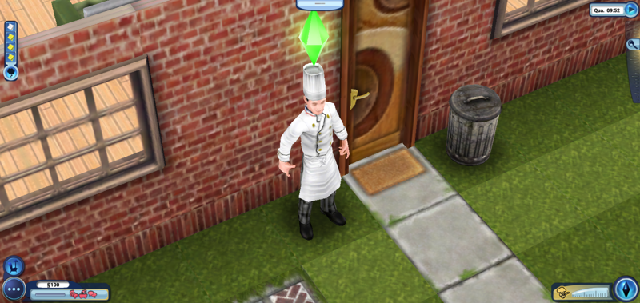
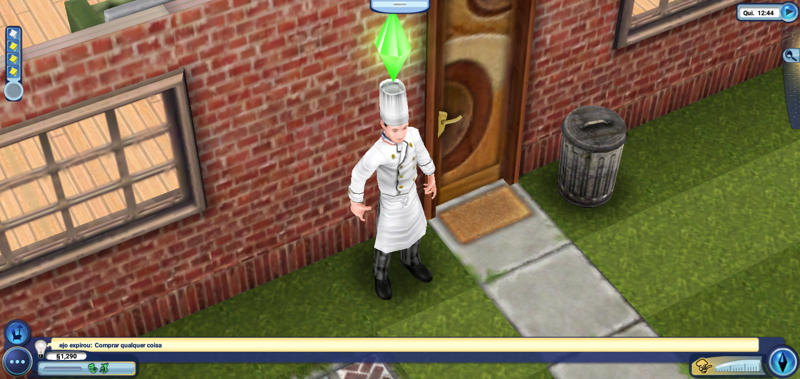
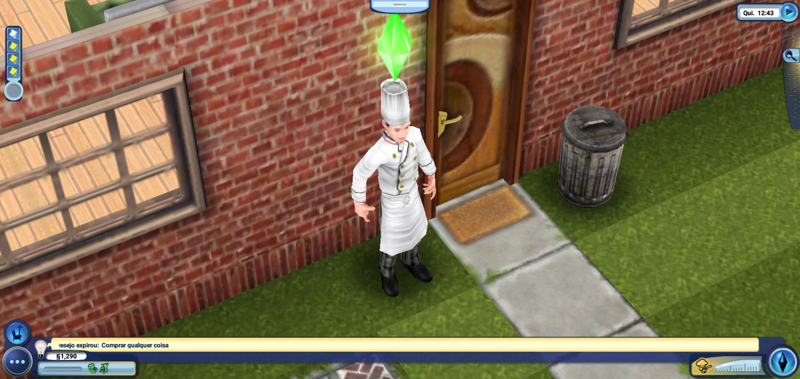

# Sprints

Cada sprint tem um objetivo verificável no celular de teste (Galaxy A10, Android 10, Mali-G71).
O status é atualizado ao final de cada sprint, com o que foi feito e o que ficou pendente.

| # | Sprint | Objetivo verificável | Status |
|---|---|---|---|
| 0 | Análise e ambiente | Saber o que precisa ser implementado; ferramentas instaladas | ✅ concluído |
| 1 | Loader Mach-O | APK carrega o binário, aplica fixups e executa os construtores estáticos e `main()` | ✅ concluído |
| 2 | Runtime ObjC + Foundation | Jogo chega em `application:didFinishLaunchingWithOptions:` e agenda o `NSTimer` principal | ✅ concluído |
| 3 | Vídeo | Primeira imagem do jogo na tela (tela de carregamento) | ✅ concluído — menu a 60 FPS |
| 4 | Entrada e tela | Toques funcionando; proporção de tela correta em telas 18:9–21:9 | ✅ toques, arraste, 19:9 nativo; outras proporções a validar em mais aparelhos |
| 5 | Áudio | Efeitos (OpenAL) e música (AudioQueue/AAC) | ✅ música e efeitos confirmados no aparelho |
| 6 | Texto e UI 2D | CoreGraphics + texto via Android; teclado para nomear Sims | ✅ inclusive CJK; teclado via diálogo nativo |
| 7 | Estabilidade | Salvar/carregar, pausa/retomada, desempenho, jogar do início ao fim | 🔶 save/load, pausa, culinária e pesca ok; falta sessão prolongada e demais sistemas |
| 8 | Distribuição | Importador de IPA/OBB dentro do app, APK de release, guia para a comunidade | ✅ importador IPA/OBB, conversor local, APK release e guias |
| 9 | Android de 32 bits | Carregar armv7 em processo armeabi-v7a e disponibilizar APK universal | 🔶 A10 em 32 bits verificado; instalação/execução no J6 confirmadas pelo usuário; falta sessão prolongada |

---

## Sprint 0 — Análise e ambiente ✅

**Feito**
- IPA extraído; confirmado que as três fatias (armv7, armv7s, arm64) estão descriptografadas.
- Inventário completo de imports, classes ObjC, seletores e assets → `01-ANALISE-BINARIO.md`.
- Ferramenta `tools/macho_objc.py` para extrair metadados ObjC (o LIEF não suporta este binário).
- Ghidra headless: todo o binário decompilado em `analysis/decomp_arm64.c`; `tools/fn.sh <addr>` imprime uma função.
- Decisão de arquitetura: loader nativo arm64 + HLE → `02-ARQUITETURA.md`.
- Ambiente: Android SDK (já existia), NDK r27c, CMake, Ghidra 11.1.2, SDL2 2.30.9,
  OpenAL Soft 1.23.1, stb_image.

**Descobertas que mudaram o plano**
- O jogo é um port J2ME da EA rodando sobre o motor C++ "midp" — a parte iOS é pequena.
- A fatia arm64 existe e está limpa → nada de emulação de CPU, desempenho nativo.
- Música é AAC em CAF; texturas pré-cozidas em PVRTC (não suportado por Mali/Adreno).

## Sprints 1–3 — Loader, runtime ObjC, Foundation/UIKit e vídeo ✅

Foram feitos juntos porque o primeiro teste útil só existe quando tudo isso funciona.

**Feito**
- `loader/macho.cpp`: mapeia o executável, aplica 6.905 rebases e 921 binds; imports sem
  implementação viram stubs que registram a chamada no log (`UNIMPLEMENTED call: ...`).
- `objc/`: runtime compatível com o layout ObjC2 da Apple — `objc_msgSend` em assembly,
  realização das 17 classes do jogo (com deslize de ivars), categorias, seletores internados,
  contagem de referências e autorelease pools.
- `hle/`: libSystem (com `FILE` e `struct stat` no layout do Darwin), libstdc++ (árvore
  rubro-negra do `std::map`), CoreFoundation/Foundation (strings, coleções, bundle, plist
  binário, file manager, timers e run loop), UIKit (app, janela, views, toques), CoreGraphics
  em software (imagens, caminhos, sombras) com texto renderizado pelo Android via JNI,
  OpenGL ES (113 funções geradas por `tools/gen_gl_wrappers.py`), decodificador PVRTC,
  OpenAL → OpenAL Soft, AudioToolbox (WAV/CAF, AudioQueue, AAC via `AMediaCodec`).
- `platform/main.cpp`: SDL2 cria a janela e dois contextos GLES 1.1 compartilhados (jogo e
  apresentação); o quadro do jogo, que é "retrato" no iOS, é girado e ajustado à tela paisagem.

**Problemas encontrados e soluções**
| Sintoma | Causa | Solução |
|---|---|---|
| Crash em `Image2D` com índice -1 | A thread de render do jogo usa GL, mas `setCurrentContext:` não ativava o EGL nela | EAGL com contexto por thread; a posse do contexto EGL migra entre threads |
| Crash após `AudioFileOpenURL` | O jogo não trata falha ao abrir áudio | AudioFile/AudioQueue reais |
| Tela presa no "carregando" | Driver Mali versiona a textura compartilhada entre contextos | `glFinish` antes de trocar de contexto (otimizar com fence EGL) |
| Tela preta em `Info.plist` sem `EAGLRenderingAPI` | O jogo cai no caminho ES 1.1 | Contexto ES 1.1 (o Mali suporta `GL_OES_matrix_palette`) |

**Resultado**: carregamento, menu principal e tela de seleção de jogo funcionando, em
português, a ~60 FPS no Galaxy A10.

**Pendências** (resolvidas nos sprints seguintes)
- ~~Trocar `glFinish` por sincronização com fence EGL.~~
- ~~Confirmar música e efeitos (escuta no aparelho).~~
- ~~Testar criação de Sim (teclado), gameplay, salvar/carregar e pausa/retomada.~~

## Sprints 4–6 — Entrada, áudio e texto ✅

**Feito**
- Toques: mapeamento janela paisagem → tela "retrato" do iOS; `tapCount`, multitoque,
  arraste (girar o Sim no Criar Um Sim, rolar listas, zoom da câmera).
- Áudio: música AAC e efeitos funcionando (confirmado de ouvido). Pausa automática em
  segundo plano.
- Texto: todos os idiomas, incluindo 繁體中文 / 简体中文 / 한국어 / 日本語.
- Nome do Sim: o `UITextField` do iOS vira um diálogo nativo do Android. Descoberta: o jogo
  só recebe o texto pelo evento `UIControlEventEditingDidEndOnExit` (tecla Enter do iOS).
- Sincronização de quadros: fence EGL com espera no GPU no lugar do `glFinish`.
- zlib (inflate + tabela CRC com entradas de 8 bytes como no zlib 1.2.5 da Apple).
  Com isso **todos os 411 imports** do jogo estão implementados.

O nome exibido nessa captura foi substituído por um exemplo para a documentação pública.

## Sprint 7 — Estabilidade 🔶

**Verificado**
- Novo jogo → Criar Um Sim → nome → mundo → tutorial.
- Save gravado em `home/Documents/sim3dat0` e carregado depois de reiniciar o app.
- Ir para outro app e voltar: superfície EGL recriada, ciclo de vida do app chamado, jogo continua.
- Menus: Opções, Idioma, Ajuda e Acerca.
- 60 FPS no menu e no mundo (Galaxy A10, Mali-G71, resolução nativa 1520×720).

- Interações com objetos (menu radial), Sim andando e sentando, "Novo Desejo".
- Menu do jogo → "Guardar e Continuar" atualiza o save.
- Memória estável (~112 MB PSS) em sessão contínua.
- Acelerômetro: sensor do Android → `UIAccelerometer` (30 Hz, eixos do aparelho).
- Seletor de foto: `UIImagePickerController` abre a galeria do Android e devolve a imagem ao jogo.
- Relatório de crash com endereços do executável original (`crash.txt`).
- Bibliotecas nativas alinhadas a 16 KB (Android 15+).

**A fazer**
- Sessão prolongada de jogo (progressão de carreiras, bebê, compra/colocação de mobília,
  construção de salas e passar vários dias); repetir culinária/pesca durante essa progressão.
- Biblioteca de música do aparelho (hoje o seletor é cancelado).
- Testar em mais aparelhos (Adreno, telas 20:9, tablets, Android 14/15).

### Sessão de estabilidade — 11/10/2026

- Galaxy A10, release já instalado, GLES 1.1, resolução nativa 1520×720.
- Backup local de `files/home` obtido antes dos testes.
- Save do Sim de teste carregado; modo construção/compra aberto, catálogo de cozinha e rolagem
  funcionando, seleção de fogão chegou à etapa de posicionamento. Compra efetiva e
  construção de salas ainda não validadas.
- Câmera por arraste e menu radial do frigorífico responderam normalmente.
- Usuário jogou por cerca de cinco minutos e confirmou **culinária e pesca funcionando,
  sem problemas até então**. Screenshot ao final mostra a pesca.
- Mesmo processo (PID 5741) permaneceu ativo desde o início da sessão. `dumpsys meminfo`
  informou TOTAL entre 112.368 e 121.743 KB nas quatro amostras, sem crescimento contínuo;
  Swap PSS chegou a 30.815 KB (o TOTAL desta versão do Android inclui swap).
- Trecho de log preservado: 19:29:28–19:32:38, normalmente ~60 FPS, quedas pontuais
  a 49,6/51,2/43,7 e 17,1 FPS, com recuperação para ~60 FPS. Causa das quedas não determinada.
  Sem `UNIMPLEMENTED`, `unrecognized selector`, `TS3A-crash` ou fatal nesse trecho.
- Problema na coleta: o buffer circular do logcat descartou o início da sessão antes do
  dump final. `tools/run.sh` agora captura continuamente desde antes de abrir o app,
  inclui `TS3A-crash` e encerra o coletor ao sair. Sintaxe verificada com `bash -n`;
  fluxo completo exercitado posteriormente no teste do release 0.1.1.
- Timeout de tela e `stay_on_while_plugged_in` restaurados aos valores anteriores
  (600000 e 0). Sprint permanece aberta para testes prolongados e outros aparelhos.

### Escala em telas Full HD+ — release 0.1.1 (11/10/2026)

- Usuário relatou ícones menores no Galaxy A50. Causa no port: o lado curto lógico
  acompanhava a resolução física até 1080 pontos, enquanto o A10 usa 720. O layout do
  jogo acaba com controles proporcionalmente menores em telas de maior resolução.
- Padrão limitado a 720 pontos no lado curto, mantendo a proporção do display. A50
  2340×1080 passa a 1560×720 lógicos; A10 1520×720 mantém sua resolução anterior.
  `short_side` e `long_side` explícitos continuam tendo prioridade. O quadro completo
  é ampliado na apresentação, incluindo os controles; há troca de nitidez por escala
  de interface e menor custo de renderização.
- `./gradlew assembleRelease` concluído, versão 0.1.1 / versionCode 2, APK em
  `dist/TS3Ambitions-0.1.1.apk`. Instalado por cima do release no A10; antes da atualização,
  app colocado em segundo plano e backup local dos saves realizado.
- A10: log confirma 720×1520 lógicos, carregamento, menu a ~60 FPS, toques para abrir
  o save do Sim de teste e mundo exibido normalmente. `tools/run.sh` modificado capturou a
  inicialização e encerrou o coletor normalmente.
- Validação visual da nova escala no A50 ainda pendente; o A50 não está conectado por adb.

## Sprint 8 — Distribuição ✅

**Feito**
- `LauncherActivity`: importa o `.ipa` escolhido pelo usuário, com barra de progresso e
  validação (arm64 presente, não criptografado). Testado no aparelho: 426 MB extraídos em ~45 s.
- Botão Voltar do Android → diálogo "Sair do jogo?".
- Build de release assinado (chave local fora do repositório), APK de **1,7 MB**.
- `README.md`, guia de compilação (`03-COMPILAR.md`) e guia do jogador (`04-GUIA-DO-JOGADOR.md`).

### Importação de OBB — release 0.1.2 (11/10/2026)

**Feito**
- `tools/ipa_to_obb.py`: conversor com biblioteca padrão do Python, preservando o IPA e
  recusando sobrescrever uma saída existente. Empacota somente os arquivos do bundle em
  ZIP/Deflate com extensão `.obb`, valida arm64 e ausência de FairPlay e confere CRC/SHA-256
  de todos os arquivos da saída contra a origem. Arquivo final publicado após verificação.
- OBB local gerado em `dist/TS3Ambitions-1.1.84.obb`: **219.765.433 bytes (209,6 MiB)**,
  1.824 arquivos, 421,9 MiB extraídos. Nenhum executável ou asset do jogo foi alterado.
- Importador com botão e instruções **IPA ou OBB**, em português e inglês. O pacote é
  selecionado em Downloads pelo Android; não depende de `Android/obb` ou versionCode.
- Extração restrita ao bundle esperado, com verificação de caminho canônico, limpeza de
  importação parcial em erro de I/O e validação dos limites do cabeçalho/comandos Mach-O.
- `.gitignore` atualizado para excluir `*.obb` e caches Python.
- APK assinado `dist/TS3Ambitions-0.1.2.apk`, versionCode 3; mantém a escala automática
  do release 0.1.1. `./gradlew assembleRelease` concluído.

**Verificação**
- Quatro testes do conversor passaram: preservação de conteúdo/exclusão de metadados do
  IPA e recusa de sobrescrita; FairPlay sem gerar saída; fat arm64/fat truncado/comandos
  inválidos/CPU incorreta; caminho fora do bundle. A conversão real verificou os 1.824 arquivos.
- A10: backup local dos saves, release atualizado sem
  desinstalar e bundle anterior temporariamente movido para exercitar a primeira importação.
- OBB copiado para Downloads, selecionado no importador e extraído; cerca de 18 s entre
  o toque no arquivo e o início do loader. Jogo abriu automaticamente, menu a ~60 FPS,
  executável importado com SHA-256 igual ao anterior e save do Sim de teste carregado no mundo.
- Sem `UNIMPLEMENTED`, seletor desconhecido ou `TS3A-crash` no log coletado do port.
  O log registrou um crash **do seletor do sistema** (`com.android.documentsui`) ao fechar
  a pesquisa, por `onSaveInstanceState`; o resultado já havia sido entregue ao app e a
  importação prosseguiu normalmente. Não houve crash do processo do port.
- Cópia temporária do bundle removida após sucesso. OBB permanece em
  `/sdcard/Download/TS3Ambitions-1.1.84.obb`; saves preservados e configurações de tela
  restauradas a 600000 / `stay_on_while_plugged_in=0`.
- `README.md`, arquitetura e guias atualizados com o formato e o fluxo de importação.

## Sprint 9 — Suporte a Android de 32 bits (12/10/2026) 🔶

**Feito**
- Loader Mach-O armv7/arm64: seleção da fatia nativa, cabeçalhos/segmentos/seções de
  32 bits, fixups com palavras de 4 bytes e preservação do bit Thumb. Armv7 usa base
  original `0x4000`, arm64 continua em `0x100000000`.
- Runtime ObjC com metadados de 32 bits, referências percorridas pela largura do ponteiro,
  `objc_msgSend`/super em Thumb e `objc_msgSend_stret` para retornos de estruturas.
- Adaptadores em `hle/abi.*` para chamadas Darwin armv7 ↔ Android AAPCS: alinhamento de
  argumentos de 64 bits, pilha de entrada de 4 bytes → chamadas Android alinhadas a 8,
  preservação de `r9` e callbacks de áudio, imagem, threads, blocks, construtores e `main`.
  `tools/gen_method_abi.py` gera os registros tipados durante a configuração CMake.
- `CGFloat=float`, `BOOL=signed char`, CFString constante com layout de 16 bytes, FILE
  Darwin de 88 bytes, stat de 108 bytes e AudioQueueBuffer de 28 bytes. UIKit com os
  tamanhos de superclasse do binário armv7. CRC usa `unsigned long` (4/8 bytes).
- Varargs armv7 reunidos dos registradores e pilha em palavras de 4 bytes; implementações
  CGFloat de CoreGraphics/UIKit e helpers geométricos adicionais. Imports adicionais de
  aritmética, ARC/propriedades e registro de frames SjLj adicionados.
- Relatório de crash com registradores ARM de 32 bits e endereços do Mach-O armv7.
- APK **0.2.0 / versionCode 4**, universal `arm64-v8a` + `armeabi-v7a`, assinado com a
  mesma chave. Artefato: `dist/TS3Ambitions-0.2.0.apk`, **3.198.952 bytes (~3,1 MiB)**.
  As quatro bibliotecas arm64 continuam com segmentos LOAD alinhados a 16 KB.
- Importador valida a arquitetura do processo (`Process.is64Bit()`), com mensagens
  armv7/arm64. O conversor valida todas as fatias compatíveis presentes, incluindo
  criptografia armv7. O OBB existente contém ambas e pode ser reutilizado.
- `tools/macho_objc.py` adaptado para os dois layouts; metadados armv7 analisados localmente.

**Problemas encontrados e soluções**
| Sintoma | Causa | Solução |
|---|---|---|
| Aborto na definição de um método HLE | Registro via lambda anônima escapava à geração de assinaturas | Métodos com funções nomeadas e registros ABI gerados |
| Contador de construtores mudava e chamava o 14º, inexistente | Código Darwin armv7 pode alterar `r9`, que o chamador Android espera preservado | Adaptadores de entrada/saída salvam `r9`; construtores e callbacks usam o caminho inverso |
| Estruturas e floats incompatíveis na interface iOS | O caminho anterior pressupunha LP64, CGFloat double e retorno arm64 | Tipos/layouts nativos e dispatcher stret de 32 bits |
| Seletor de arquivos do sistema registra exceção ao fechar pesquisa | Bug já observado em `com.android.documentsui` do A10 | Resultado foi entregue e importação prosseguiu; não houve crash do port nessa importação |

**Verificado no A10**
- Testes nativos de ABI (`bash tools/test_armv7_abi.sh`) passaram: argumentos em registradores
  e pilha, 64 bits em limites diferentes, pilha de entrada desalinhada para AAPCS, `r9` e
  troca de destino no cache. Fixtures em assembly autoral, sem código do jogo.
- Seis testes Python do conversor passaram, incluindo thin armv7, pacote universal e
  armv7 criptografado mesmo quando arm64 é válida.
- `./gradlew assembleRelease --max-workers=2` concluído. APK inspecionado: oito libs,
  quatro para cada ABI. Testado o mesmo APK com `adb install -r --abi armeabi-v7a ...`
  e depois `--abi arm64-v8a ...`, sem desinstalar ou perder saves.
- Processo de 32 bits: importação real do OBB pelo seletor, abertura automática, menu
  a ~60 FPS, mundo/Sim exibidos, controles, diálogo de guardar e arquivo de save atualizado
  (SHA-256 mudou). Pausa/Home e retorno pelo launcher exibiram o mundo normalmente.
- Save gravado em 32 bits foi carregado após reiniciar em 32 bits e também em 64 bits.
  Nas duas ABIs, houve quedas temporárias de FPS durante carregamento do mundo.
- Amostra de memória em 32 bits: `dumpsys meminfo` TOTAL 110.268 KB, incluindo Swap PSS
  de 52.190 KB. Não foi feita uma nova série longa de medições.
- Logs finais do jogo sem chamadas `UNIMPLEMENTED`, seletores desconhecidos ou crash.
  A fatia armv7 tem código extra de serviços EA/RestKit/CoreData: o loader ainda registra
  **330 sites de bind não resolvidos**, em stubs/blocos de dados. Esses caminhos não foram
  exercitados; isso não equivale à cobertura integral dos imports armv7.
- Backup local dos saves realizado antes dos testes. A cópia
  temporária do bundle usada na reimportação foi removida. A10 terminou com a ABI arm64,
  timeout restaurado a 600000 e `stay_on_while_plugged_in=0`.
- Relatório do crash inicial de `r9` arquivado localmente e removido do aparelho após
  os testes finais, para não confundi-lo com um crash novo.

**A validar**
- Sessão prolongada no Galaxy J6, outras GPUs e dispositivos de pouca memória.
- Sessões prolongadas, minigames e demais recursos no caminho armv7. Inicialização de
  áudio foi observada, mas não houve nova confirmação de escuta do caminho de 32 bits.
- Serviços adicionais da fatia armv7, se forem necessários a algum fluxo do jogo.

**Confirmação no Galaxy J6 — APK 0.2.1**
- Usuário confirmou: “perfeito, está funcionando agora no J6”. Instalação e execução
  verificadas pelo usuário no aparelho real; FPS, versão do Android e cobertura dos
  recursos de gameplay ainda não informados.
- O bloqueio de instalação relatado antes da inclusão de `armeabi-v7a` está resolvido.

## Atualização visual — ícone do launcher, release 0.2.1 (12/10/2026)

- Substituído o ícone de casa por um desenho autoral do port: plumbob verde facetado,
  fundo azul-escuro e selo dourado com o número 3. Nenhum asset do IPA foi incorporado ao APK.
- Ícone adaptativo para Android 8+, com camadas vetoriais de fundo e primeiro plano,
  conteúdo na área segura das máscaras de launcher e `roundIcon` no manifest.
- PNGs de compatibilidade atualizados nas cinco densidades (48, 72, 96, 144 e 192 px).
  Prévia em `docs/img/icone.png`; `tools/gen_icon.py` renderiza os mesmos vetores para
  os PNGs e a prévia, usando Pillow.
- `./gradlew assembleRelease --max-workers=2` concluído. APK universal **0.2.1 /
  versionCode 5**, assinado com a mesma chave, em `dist/TS3Ambitions-0.2.1.apk`.
- `aapt2 dump badging` confirma versão, Android mínimo 8.0, as duas ABIs e referência
  ao ícone. O XML compilado do ícone foi conferido: adaptativo com fundo/primeiro plano.
  As oito bibliotecas nativas continuam empacotadas (quatro por ABI).

## Publicação do código no GitHub

- Código-fonte, ferramentas, dependências de terceiros com seus avisos de licença e
  documentação técnica preparados para publicação pública.
- IPAs, OBBs, executáveis/assets extraídos, saves, relatórios locais, builds e chaves de
  assinatura excluídos do controle de versão. Caminhos pessoais removidos dos scripts e
  nome de teste anonimizado no histórico e na captura correspondente.
- Informações de continuidade técnica organizadas em `05-DESENVOLVIMENTO.md`;
  anotações locais de aparelho e ambiente permanecem privadas.
